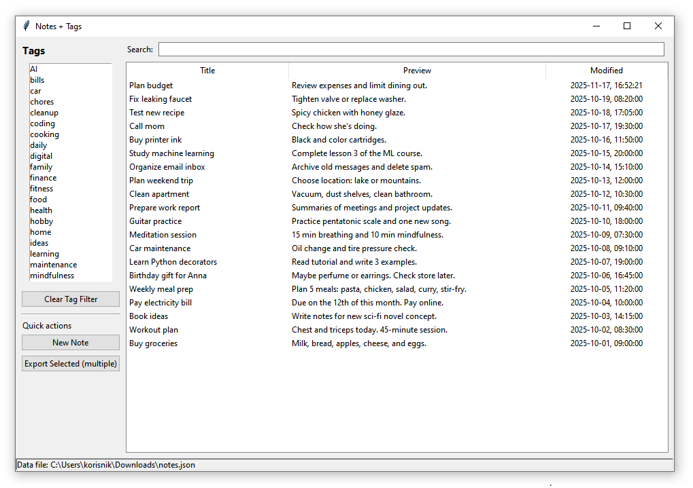
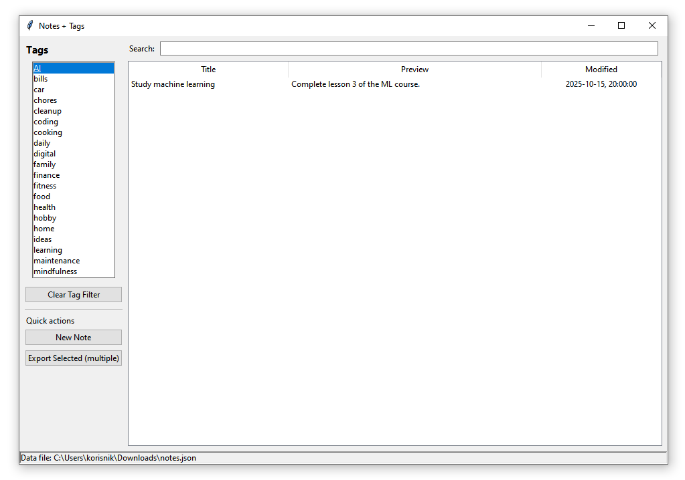
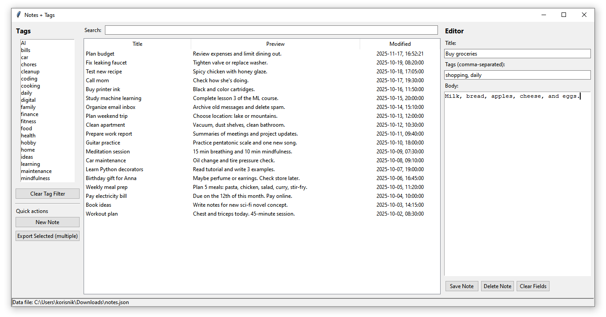

# Notes + Tags App (Python + Tkinter)


## About the Project

Notes + Tags App is an offline desktop application built with **Python** and **Tkinter** for creating, organizing, and managing personal notes.

Users can create, edit, delete, search, and filter notes using tags. Multiple selected notes can also be exported into one text file.

All notes are stored locally in JSON format. The application includes data validation, automatic backups, and safer file-saving operations.

## Screenshots

### Main Window



### Tag Filtering



### Note Editor



## Features

- Create, edit, and delete notes.
- Organize notes with multiple tags.
- Search notes by title, body, or tags.
- Live search while typing.
- Filter notes by selected tag.
- Combine search and tag filtering.
- Display note previews and modification timestamps.
- Track creation and modification dates.
- Select and export multiple notes into one text file.
- Include timestamps and tags in exported notes.
- Store notes locally in JSON format.
- Normalize older note data formats.
- Validate JSON data before processing it.
- Create a backup before replacing the existing notes file.
- Use temporary files for safer saving.

## Technologies Used

- Python
- Tkinter and ttk
- JSON
- pathlib
- uuid
- datetime
- tempfile
- os
- shutil

## Requirements

- Python **3.7 or newer**
- Tkinter (normally included with standard Python installations)

No external Python packages are required.

## Project Structure

```text
notes-tags-app-python/
├── notes_tags_app.py
├── README.md
├── building-notes-tags-app-python-tkinter-json.md
├── requirements.txt
├── .gitignore
├── data/
│   ├── notes.json
│   └── notes.json.bak
└── screenshots/
    ├── main-window.png
    ├── tags-filter.png
    └── editor-view.png
```

The `data/` directory and JSON files are created automatically when the application runs. They do not need to be included in the repository.

## Installation

1. Clone or download this repository.
2. Open the project folder.
3. Run the application:

   ```bash
   python notes_tags_app.py
   ```

## Data Storage and Backups

Notes are stored in:

```text
data/notes.json
```

Before replacing an existing notes file, the application creates a backup:

```text
data/notes.json.bak
```

The application also writes new data to a temporary file before replacing the original. If the JSON file cannot be read or has an unexpected structure, the application reports an error rather than automatically treating it as an empty notes collection.

**Important:** Keep personal notes and backup files out of public repositories. The data directory is intended for local application data.

## Timestamp Format

The application uses the following timestamp format:

```text
YYYY-MM-DD, HH:MM:SS
```

Older supported timestamp formats are normalized when the notes are loaded.

## Compatibility

The development history records compatibility with:

- Python 3.7.3
- Python 3.14.10

The application uses Python's standard library and does not require external packages.

## Future Improvements

- Rich text and Markdown support.
- Import notes from TXT or Markdown files.
- Tag management.
- Favorite or pinned notes.
- Keyboard shortcuts.
- Dark mode.
- Search result highlighting.
- Backup restoration interface.

## Article

For a more detailed explanation of the design, implementation, and development process, see:

[Building a Notes and Tags App with Python and Tkinter](article.md)
